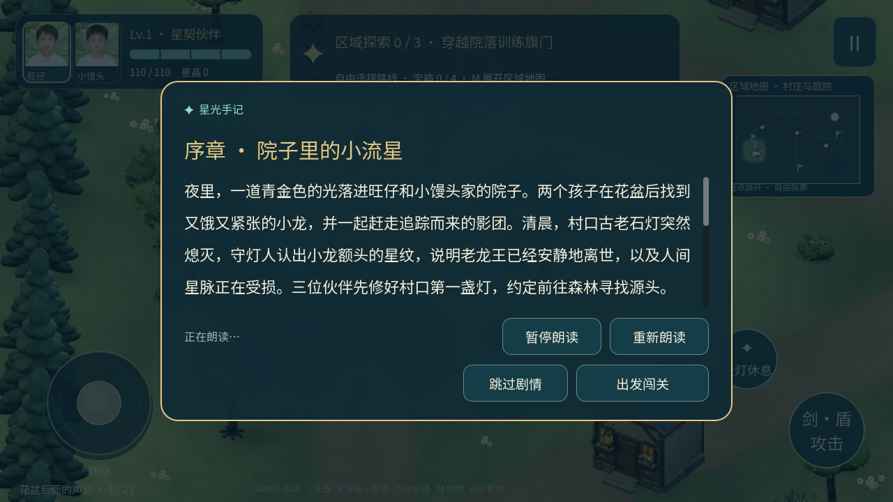
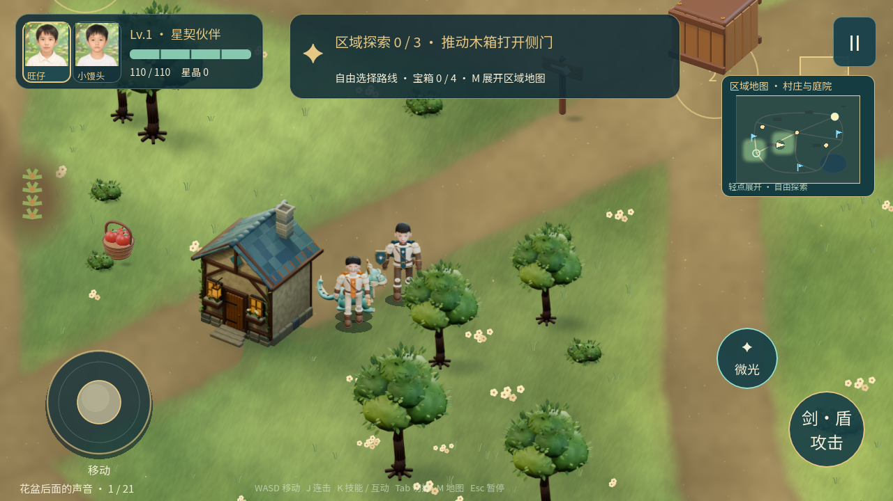

# 星灯岛与回家的小龙

基于原故事与角色模型制作的横屏单机冒险游戏，使用 Godot 4.7.2，版本 1.4.0。支持双角色切换、手机触屏摇杆和键盘操作。

## 下载

[Android arm64 安装包与 iOS 构建](https://github.com/swaggyer/game/releases/tag/v1.4.0)

Android APK 为独立签名安装包，适用于支持 arm64 的安卓设备。尚未进行安卓真机试玩。iOS 构建为未签名 IPA，并提供完整 Xcode 工程；**未签名 IPA 不能直接安装到普通 iPhone**，需要在 Mac 上配置个人开发或正式发布签名。

[iOS 构建记录与工程下载](https://github.com/swaggyer/game/actions/workflows/mobile-build.yml) · [iOS 签名说明](mobile_game/docs/IOS发布说明.md)

## 安卓性能与操作响应修复

v1.4.0 针对首图走路与战斗卡顿，合并静态草叶花朵绘制、简化地表着色，预热动作与音乐，攻击和龙术在按下时起手，减少重复HUD更新、寻路与主线程自动存档。安卓包沿用原签名，可直接覆盖更新并保留存档。[原因、验证结果与说明](mobile_game/docs/V1.4性能修复.md)。桌面对比不代表一加13T真机帧率，本次尚未在该机型复测。

## 音乐与剧情朗读

七区独立配乐，另含标题、普通战斗和首领曲；全部剧情提供离线中文旁白，支持暂停、重听、跳过。声音设置可调音乐、音效和旁白音量。



## 已实现玩法

- 七个 3400×2400 开放区域，含自然草地、水面、树林、建筑、交叉道路和真实碰撞。
- 21 组主线、63 个主动目标；每区额外三个挑战，共 21 个可重玩关卡，包含限时障碍、分波战斗、踏板光栅、移动靶和粮车护送。
- 旺仔近战三段剑盾连击、小馒头远程星矢、小龙寻路跟随；三位角色都有八方向步态。
- 妖怪每次有效命中至少扣最大生命的四分之一；走位、水盾和受击保护可以避免伤害。
- 成长、装备、源晶能力、营地、宝箱、首领阶段、挑战勋章与本地存档。



## 开发与验证

用 Godot 4.7.2 导入 `mobile_game/project.godot`，等待资源导入后运行。故事数据在 `design_web/content`，原始 Blender 模型在 `source_models`，重渲染工具在 `mobile_game/tools`。

```sh
godot --headless --editor --path mobile_game --import --quit
godot --headless --path mobile_game --script tests/test_full_game_v12.gd
```

完整玩法基线通过 5589 项检查，另有原生渲染与运行包验证。v1.3.0 修复血量文字遮挡；公开版本使用开源 Noto Sans SC 及内嵌符号后备字体。Android 安装包进行签名与包结构校验，iOS 在 GitHub macOS runner 原生编译；实际状态以 Actions 记录为准。

字体授权与来源在 `mobile_game/assets/font-license`，Godot 授权在 `third_party/licenses`。本仓库没有替用户设定原创游戏代码、故事、美术或人物肖像的开放许可；第三方文件按各自许可使用。安装包、构建缓存、存档、原始照片与签名私钥不提交到源码树。
